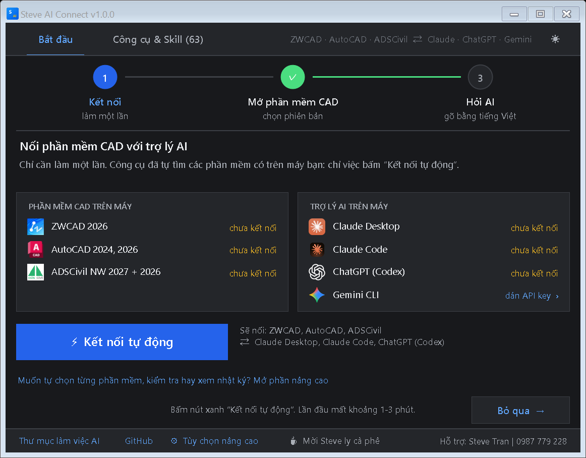
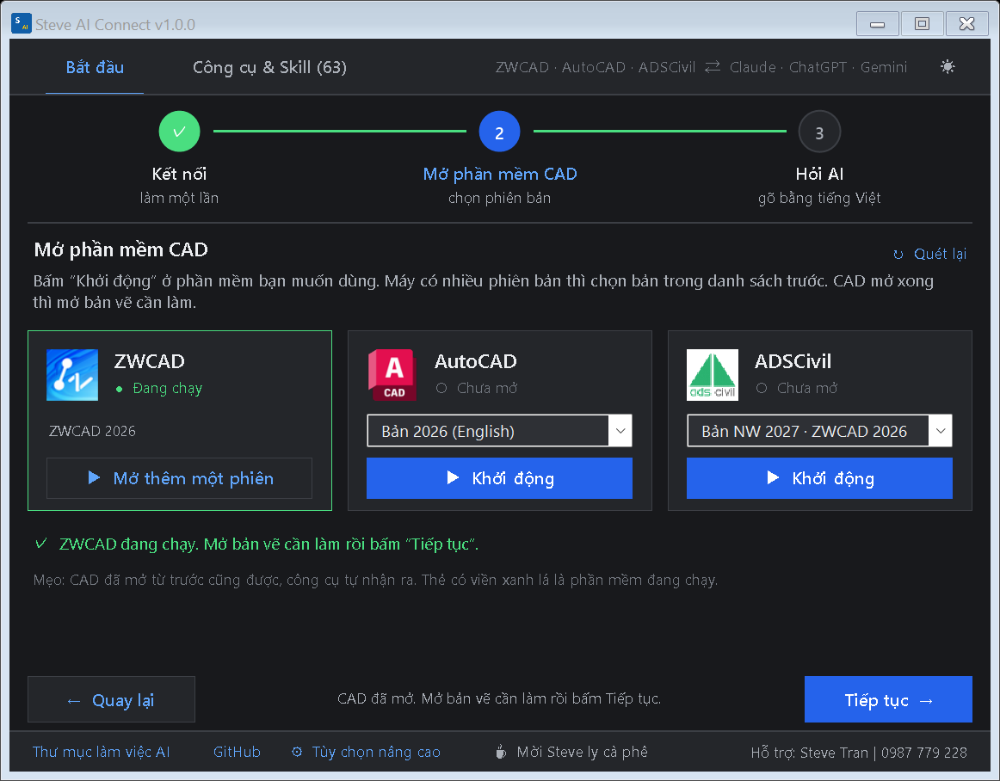
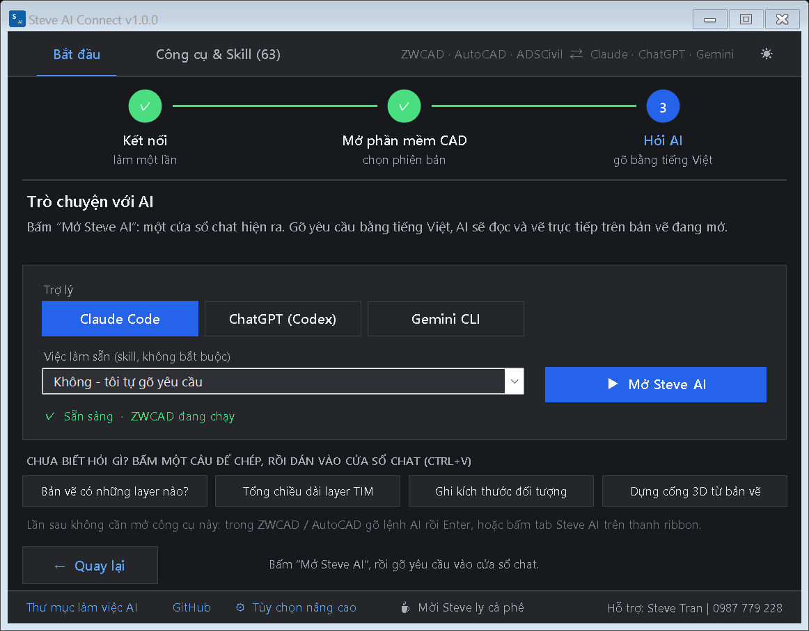

# Steve AI Connect

**Kết nối ZWCAD · AutoCAD · ADSCivil với Claude · ChatGPT · Gemini bằng một cú bấm.**

Sau khi kết nối, bạn chỉ cần trò chuyện với trợ lý AI và nó sẽ **điều khiển trực tiếp phần mềm CAD đang mở**: đọc layer và đối tượng, vẽ, sửa, chèn block, chạy lệnh, tra tiêu chuẩn TCVN (với ADSCivil)... Việc kết nối dùng **MCP** (Model Context Protocol).



> **Liên hệ hỗ trợ:** Steve Tran | 0987 779 228

## Dùng thế nào

1. **Tải về:** vào trang [**Releases**](https://github.com/steve-trantn/Steve-AI-Connect/releases/latest), tải file **`Steve-AI-Connect-Setup-*.exe`** (một file duy nhất, có thể gửi qua Zalo, email, USB).
2. **Bấm đúp file exe.** Công cụ tự cài (không cần quyền admin), tạo shortcut trên Desktop rồi mở ra ở thẻ **Bắt đầu**, dẫn bạn đi qua 3 bước. Bước nào xong có dấu ✓ xanh, lần sau mở công cụ sẽ vào thẳng bước còn dang dở.
   - **Đăng ký một lần** (miễn phí): nhập email, họ và tên, SĐT, nhận mã 6 số qua email rồi xác nhận. Máy khác chỉ cần **Đăng nhập** bằng email. Đăng ký xong dùng được cả khi không có mạng; nếu lúc đăng ký không kết nối được máy chủ thì được dùng tạm 7 ngày.
   - **Bước 1 · Kết nối** (làm một lần): công cụ tự tìm phần mềm CAD và trợ lý AI có trên máy. Bấm **Kết nối tự động**. Máy chưa có trợ lý AI thì công cụ chỉ chỗ tải Claude Code.
   - **Bước 2 · Mở phần mềm CAD:** chọn phiên bản (máy có nhiều bản, ví dụ ADSCivil 2026 và 2027, thì chọn trong danh sách xổ xuống) rồi bấm **Khởi động**. CAD mở xong, công cụ tự chuyển sang bước 3.
   - **Bước 3 · Hỏi AI:** bấm **Mở Steve AI**, gõ yêu cầu bằng tiếng Việt, ví dụ *"Bản vẽ đang mở có những layer nào?"*. Chưa biết hỏi gì thì bấm một câu gợi ý để chép rồi dán (Ctrl+V).
3. Lần sau không cần mở công cụ: trong ZWCAD / AutoCAD gõ `AI` rồi Enter, hoặc bấm tab **Steve AI** trên ribbon.

| Bước 2 | Bước 3 |
|---|---|
|  |  |

Người dùng quen tay có thể vào thẻ **Kết nối (nâng cao)** để tự chọn từng cặp CAD ⇄ trợ lý, kiểm tra, ngắt kết nối và xem nhật ký.

Câu hỏi để thử (ZWCAD, AutoCAD):

| Mục đích | Câu hỏi |
|---|---|
| Đọc | "Bản vẽ có những layer nào, mỗi layer bao nhiêu đối tượng?" |
| Tính | "Tính tổng chiều dài và diện tích các polyline đang chọn." |
| Đếm | "Đếm số lượng từng loại block trong bản vẽ." |
| Dọn | "Tìm các đối tượng bị trùng trên layer 0 (chưa xoá)." |
| Vẽ | "Tạo layer AI-TEST màu đỏ, vẽ hình chữ nhật 1000×500 tại gốc toạ độ rồi ghi kích thước các cạnh." |
| Sửa | "Chuyển các text đang chọn sang layer TEXT màu vàng." |
| Xem | "Chụp màn hình và cho biết bản vẽ đang có gì." |
| 3D | "Dựng cống 3D từ bản vẽ này: cao độ đáy đầu vào 3.31, đầu ra 3.25, tuyến cống hướng 30°." |
| IFC | "Đặt cống về toạ độ X=..., Y=..., góc 30°, đặt layer theo tên cống và lý trình rồi xuất IFC 4.3." |
| PDF | "Đọc bản vẽ cống trong D:\cong.pdf và dựng mô hình 3D." |

Kết nối xong có thể đóng công cụ, khởi động lại máy cũng không mất kết nối. Công cụ tạo shortcut **Steve AI Connect** trên Desktop và trong Start menu để mở lại khi cần.

| Muốn | Làm |
|---|---|
| Ngắt kết nối | Thẻ **Kết nối (nâng cao)**: tích chọn mục muốn ngắt, bấm **Ngắt kết nối** |
| Kiểm tra | Mở phần mềm CAD, bấm **Kiểm tra**: công cụ đọc thử danh sách layer của bản vẽ đang mở |
| Gỡ bỏ | **Tùy chọn nâng cao → Gỡ cài đặt**, hoặc chạy `Uninstall.cmd`, hoặc vào *Settings → Apps → Steve AI Connect → Uninstall* |

> File exe chưa có chữ ký số nên Windows SmartScreen có thể cảnh báo "Windows protected your PC": bấm **More info → Run anyway** (Thông tin thêm → Vẫn chạy).

## Phần mềm CAD hỗ trợ

| CAD | MCP server | Yêu cầu | Chi tiết |
|---|---|---|---|
| **ZWCAD** | **Steve CAD MCP** (viết riêng, [server/](server)), 75 tool | ZWCAD 2020+; Python tự cài nếu thiếu | [CAD/ZWCAD](CAD/ZWCAD) |
| **AutoCAD** | **Steve CAD MCP**, cùng 75 tool | AutoCAD 2018+ (bản đầy đủ, không phải LT) | [CAD/AutoCAD](CAD/AutoCAD) |
| **ADSCivil** | `AdsMcpServer.exe` có sẵn trong ADSCivil 2027, khoảng 290 tool nghiệp vụ | ADSCivil NW 2027 For ZWCAD 2026 | [CAD/ADSCivil](CAD/ADSCivil) |

Máy có phần mềm nào thì ô đó mới bật. Nối nhiều CAD cùng lúc được: mỗi CAD là một server riêng (`zwcad`, `autocad`, `adscivil`).

**Steve CAD MCP (ZWCAD, AutoCAD) có gì:**

- **Gom UNDO:** mỗi lần AI sửa bản vẽ là **một** bước UNDO.
- **Ghim bản vẽ:** đổi tab giữa chừng thì AI không vẽ nhầm sang bản vẽ khác.
- **Lọc ngay trong CAD:** bản vẽ lớn vẫn đọc nhanh.
- **Đọc đối tượng đang chọn:** AI biết "các đối tượng này" là gì.
- **Tool tính toán:** chiều dài, diện tích, đếm block, tìm đối tượng trùng nhau.
- **Ghi kích thước tự động** cho mọi cạnh.
- **Chụp màn hình:** AI tự xem kết quả đã vẽ.
- **Dựng 3D:** mặt cắt trong bản vẽ được đưa lên đúng hướng tuyến, góc chéo, cao độ, độ dốc rồi đùn thành khối solid. Các khối cộng, trừ, giao và cắt chéo được.
- **Toạ độ thật, layer tự động, xuất IFC4 / IFC4.3:** đưa mô hình về toạ độ công trình; đặt layer theo tên cống + lý trình + bộ phận; xuất IFC có thông tin phi hình học (công trình, lý trình, bộ phận, vật liệu, khối lượng).
- **Đọc PDF:** xem trang PDF như ảnh, hoặc nhập nét vẽ vector vào bản vẽ.
- **Đọc chữ font TCVN3/VNI:** chữ trong bản vẽ cũ được giải mã sang Unicode.
- **Skill:** quy trình làm sẵn cho việc nhiều bước. `cong-3d` (dựng cống 3D từ DWG/PDF), `viet-lisp` (viết, kiểm tra và chạy thử AutoLISP trên bản vẽ nháp), `kiem-tra-ban-ve` (soát lỗi), `boc-khoi-luong` (bóc khối lượng, xuất Excel), `chuan-layer`, `pdf-sang-cad`, `khung-ten` (điền khung tên, danh mục bản vẽ), `xuat-ifc` (xuất khối 3D ra IFC4 / IFC4X3), `tao-skill` (biến quy trình của bạn thành skill riêng, lưu ở `Steve-CAD-AI\skills`).
- **Báo lỗi tiếng Việt:** báo rõ khi CAD đang bận hoặc bị hộp thoại chặn.

Chi tiết: [server/README.md](server/README.md).

## Steve AI: làm việc với AI ngay trong CAD

- **Bước 2 trên thẻ Bắt đầu:** khởi động ZWCAD / AutoCAD / ADSCivil. Máy cài nhiều phiên bản thì chọn bản trong danh sách xổ xuống; công cụ nhớ bản đã chọn cho lần sau. Logo là logo thật lấy từ phần mềm đã cài; thẻ có viền xanh lá là CAD đang chạy.
- **Khung chat:** trong ZWCAD, AutoCAD / Civil 3D (2021-2024, 2026-2027), gõ `AI` là khung Steve AI tự gắn cạnh bản vẽ (`STEVEAIPANEL` để ẩn/hiện). Từ công cụ, shortcut hoặc AutoCAD 2025 thì khung chat mở thành cửa sổ riêng. Cần Windows 10 1809+ và Microsoft Edge WebView2; thiếu thì dùng cửa sổ terminal như trước (hoặc tự chọn trong ⚙ Tùy chọn nâng cao).
- **Bảng không cần AI:** *Kiểm tra bản vẽ*, *Bóc khối lượng*, *Khung tên*, *Chuẩn layer* mở thành bảng ngay trong khung gắn vào CAD (ribbon hoặc nút **＋**): quét, zoom, sửa, xuất Excel, không tốn lượt AI. Việc khó hơn thì bấm **Nhờ AI** trong bảng.
- **Mở Steve AI:** mở cửa sổ Claude Code / ChatGPT Codex / Gemini CLI đã nối sẵn với CAD, có thể chọn kèm một skill (ví dụ `cong-3d`).
- **Trong ZWCAD / AutoCAD:** tab ribbon **Steve AI**, hoặc gõ lệnh `AI` (mở ngay trợ lý), `STEVEAI` (chọn trợ lý), `STEVEAI-SKILL` (chạy skill), `AI-CONG-3D`, `STEVECAD` (mở công cụ này). Lệnh được nạp tự động mỗi khi mở CAD.
- Shortcut **Steve AI** trên Desktop mở thẳng cửa sổ AI.

## Trợ lý AI hỗ trợ

| Trợ lý | Cần gì | Ghi chú |
|---|---|---|
| **Claude Desktop** | [Claude Desktop](https://claude.ai/download), đăng nhập | Hỗ trợ cả bản Microsoft Store và bản cài thường |
| **Claude Code** | Claude Code | Nối ở phạm vi user, dùng được ở mọi thư mục |
| **ChatGPT (Codex)** | App **Codex** (Microsoft Store), đăng nhập ChatGPT | Mở thư mục làm việc `Steve-CAD-AI` trong Codex |
| **Gemini CLI** | **API key** miễn phí tại <https://aistudio.google.com/apikey> | Công cụ tự cài Node.js và Gemini CLI. Dán key vào ô *Gemini API key*. Mở bằng nút **Mở Steve AI** hoặc shortcut **Steve AI** |

ChatGPT bản web không dùng được vì chỉ nhận MCP server từ xa qua HTTPS.

## Công cụ làm gì trên máy

- **ZWCAD, AutoCAD:** chép Steve CAD MCP vào `%LOCALAPPDATA%\SteveCADConnect\server` và tạo môi trường Python riêng (thư viện `mcp`, `pywin32`, `pillow`). Server chỉ nói chuyện với CAD qua COM, không gửi dữ liệu ra ngoài.
- **Cho AI chạy script (tuỳ chọn, mặc định tắt):** ô *"cho AI chạy script Python"* bật tool `run_script` để AI xử lý hàng loạt. AI sẽ tự chạy mã trên máy, nên chỉ bật khi cần.
- **Đăng ký server** vào cấu hình của từng trợ lý AI đã chọn. Mọi file cấu hình được sao lưu trước khi sửa (`*.bak-<thời gian>`).
- **Tạo thư mục làm việc** `%USERPROFILE%\Steve-CAD-AI` với lời dặn cho AI (`AGENTS.md`, `CLAUDE.md`, `GEMINI.md`): luôn đọc bản vẽ thật bằng tool, hỏi trước khi xóa, lưu hoặc đóng bản vẽ.
- **ADSCivil 2026** (tùy chọn): chép trợ lý AI của bản 2027 sang và cho nó tự nạp khi khởi động (lệnh `ADSAI`). Chỉ xin quyền admin khi cần.
- **AutoCAD / Civil 3D:** plugin nằm ở `%APPDATA%\Autodesk\ApplicationPlugins\SteveAI.bundle`. Công cụ hỏi một lần có thêm 3 thư mục của Steve AI vào *Trusted Locations* không; chỉ thêm khi bạn đồng ý, tắt được trong ⚙ Tùy chọn nâng cao.
- **Đăng ký:** công cụ chỉ gửi email, họ tên, SĐT, lựa chọn đồng ý và số phiên bản tới Google Sheet riêng của Steve Tran, dùng để hỗ trợ và báo bản cập nhật (giới thiệu sản phẩm chỉ khi bạn tích chọn). Công cụ không gửi bản vẽ về đó và không theo dõi việc sử dụng (báo lỗi là mục riêng, xem dưới). Muốn xem hoặc xoá thông tin: liên hệ 0987 779 228.
- **Cập nhật:** mỗi lần mở, công cụ hỏi GitHub xem có bản mới không (không gửi thông tin cá nhân). Có bản mới thì hiện link ở góc trên; bấm **Cập nhật ngay** là xong, hoặc bật **Tự động cập nhật** trong ⚙ Tùy chọn nâng cao. File tải về phải khớp mã SHA-256 của GitHub mới được chạy.
- **Chia sẻ skill:** ⚙ Tùy chọn nâng cao → *Chia sẻ skill của tôi*. Công cụ đóng gói nguyên thư mục skill (kể cả file LISP, Excel, ảnh kèm theo, tối đa 5 MB), cho bạn xem trước, đồng ý giấy phép Apache 2.0 rồi mới gửi, kèm email và tên ghi công. Máy chủ kiểm tra mã SHA-256 rồi lưu vào Google Drive riêng của Steve và trả mã biên nhận; bản sao nằm ở `Steve-CAD-AI\skills-da-gui`. Steve duyệt và đưa vào bản cập nhật, có ghi công.
- **Báo lỗi ẩn danh (chỉ khi bạn đồng ý):** công cụ hỏi một lần. Chỉ gửi nội dung lỗi, vị trí trong mã, phiên bản Windows, CAD và công cụ; tên người dùng, tên máy, email, SĐT, đường dẫn và tên file được lọc bỏ trước khi gửi. Bật / tắt trong ⚙ Tùy chọn nâng cao.
- **Báo lỗi cho Steve:** nút *Báo lỗi* trên ribbon hoặc trong ⚙. Bạn xem đúng nội dung sẽ gửi (mô tả, email, thông tin chẩn đoán đã lọc tên, đường dẫn, email, SĐT) rồi mới bấm gửi; không kèm bản vẽ.
- **Đề xuất tính năng:** bấm **✎ Đề xuất tính năng** ở chân cửa sổ. Nội dung bạn gõ và email được gửi tới Google Sheet của Steve Tran.
- **Uninstall** gỡ sạch tất cả: ngắt kết nối, tắt tự nạp, xóa server, shortcut và mục trong Settings → Apps. Riêng thư mục làm việc (có API key) được giữ lại.

## Dòng lệnh (cho IT, cài hàng loạt)

```bat
Steve-AI-Connect-Setup-v1.8.4.exe -Connect                                           :: cai + ket noi, khong mo giao dien
powershell -ExecutionPolicy Bypass -File app\SteveCADConnect.ps1 -Connect                 :: moi CAD + moi tro ly co tren may
powershell -ExecutionPolicy Bypass -File app\SteveCADConnect.ps1 -Connect -Cad zwcad -Client codex,claude -Test
powershell -ExecutionPolicy Bypass -File app\SteveCADConnect.ps1 -Connect -Ads2026 -GeminiKey <key>
powershell -ExecutionPolicy Bypass -File app\SteveCADConnect.ps1 -Connect -Cad zwcad -AllowScript   :: bat run_script
powershell -ExecutionPolicy Bypass -File app\SteveCADConnect.ps1 -Disconnect -Cad autocad
powershell -ExecutionPolicy Bypass -File app\SteveCADConnect.ps1 -ListVersions             :: cac ban CAD da cai
powershell -ExecutionPolicy Bypass -File app\SteveCADConnect.ps1 -Launch adscivil          :: khoi dong, nhieu ban thi hoi chon
powershell -ExecutionPolicy Bypass -File app\SteveCADConnect.ps1 -Launch autocad -CadVersion 2024
powershell -ExecutionPolicy Bypass -File app\SteveCADConnect.ps1 -Uninstall
```

Cài bằng dòng lệnh không cần đăng ký ngay: máy được dùng tạm 7 ngày, sau đó mở Steve AI Connect để đăng ký.

## Xử lý sự cố

| Hiện tượng | Cách xử lý |
|---|---|
| AI trả lời "không xem được màn hình", không thấy dòng gọi tool (`zwcad/...`, `adscivil/...`) | Thoát hẳn trợ lý AI rồi mở lại, mở cuộc trò chuyện mới. Codex: mở thư mục `Steve-CAD-AI`. Log lỗi Codex nằm ở `%USERPROFILE%\.codex\logs_2.sqlite` |
| Gemini: `IneligibleTierError` | Dùng API key, không đăng nhập Google |
| Gemini: server bị `Disabled` | Mở Gemini bằng nút **Mở Steve AI** (mở trong thư mục đã đánh dấu tin cậy) |
| Kiểm tra báo "chưa đọc được bản vẽ" | Mở CAD và một bản vẽ, bấm Esc để thoát lệnh hoặc hộp thoại đang mở, rồi thử lại |
| ADSCivil: "Cannot reach ADSCivil" | Mở ADSCivil (không phải ZWCAD thường) và một bản vẽ |
| Mở nhiều phiên CAD cùng lúc | Server nối vào phiên mà Windows đăng ký trước. Nên chỉ mở một phiên |
| Gõ `AI` báo *Unknown command* | Đóng hẳn CAD rồi mở lại từ bước 2 của thẻ **Bắt đầu** (công cụ tự đăng ký lại lệnh khi CAD đã đóng). Hoặc bấm **Kết nối lại** ở bước 1 |
| AI báo CAD "bị chặn bởi hộp thoại" | Đóng hộp thoại đang mở trong CAD (ví dụ hộp thoại bản quyền của AutoCAD), rồi thử lại |
| Vẫn chưa được | Liên hệ **Steve Tran, 0987 779 228** |

## Cấu trúc

```
Steve AI Connect.cmd    bấm đúp để mở công cụ
Uninstall.cmd               gỡ toàn bộ
LICENSE, NOTICE             giấy phép Apache 2.0 và thông tin ghi nguồn
app/                        SteveCADConnect.ps1 (dòng lệnh), gui.ps1 (giao diện), core.ps1, SteveAI.ps1 (mở cửa sổ AI), cadmenu.ps1 (tab ribbon)
CAD/ZWCAD/                  lời dặn AI cho ZWCAD
CAD/AutoCAD/                lời dặn AI cho AutoCAD
server/                     Steve CAD MCP (ZWCAD, AutoCAD)
CAD/ADSCivil/               lời dặn AI, tự nạp ADSCivil 2026 (ads-ai-autoload.lsp, install-2026-autoload.ps1)
templates/                  lời dặn chung, SteveAI.lsp (lệnh AI, STEVEAI trong CAD), launcher Gemini
chat/                       khung chat (SteveAIChat.exe) và plugin gắn vào ZWCAD (SteveAIPanel)
register/                   máy chủ đăng ký (Google Apps Script) và cách cài
build/                      build-exe.ps1 + SteveCADSetup.cs: đóng gói thành dist\Steve-AI-Connect-Setup-<version>.exe
```

## Liên hệ

**Steve Tran** · 0987 779 228 · [github.com/steve-trantn](https://github.com/steve-trantn)

Báo lỗi hoặc góp ý: gọi trực tiếp, hoặc mở [Issue](https://github.com/steve-trantn/Steve-AI-Connect/issues) trên GitHub.

## Bản quyền và ghi nguồn

Steve AI Connect (gồm Steve AI và Steve CAD MCP trong thư mục `server/`) © 2026 **Steve Tran**, phát hành theo giấy phép [Apache 2.0](LICENSE).

Bạn được dùng miễn phí, sửa và chia sẻ lại, kể cả trong công việc thương mại, **với điều kiện ghi nguồn**: giữ nguyên file [NOTICE](NOTICE) trong mọi bản sao hoặc bản sửa, và ghi rõ tác giả khi giới thiệu. Dòng ghi nguồn có thể dán:

```text
Dựa trên Steve AI Connect của Steve Tran - https://github.com/steve-trantn/Steve-AI-Connect (giấy phép Apache 2.0).
```

Trong công cụ cũng có sẵn: **⚙ Tùy chọn nâng cao → Giới thiệu & ghi nguồn → Chép thông tin ghi nguồn**. Trích dẫn trong tài liệu, báo cáo: dùng nút **Cite this repository** ở trang GitHub (file [CITATION.cff](CITATION.cff)).

ZWCAD, AutoCAD, ADSCivil, Claude, ChatGPT và Gemini là thương hiệu của các chủ sở hữu tương ứng. Repo không chứa file nào của các phần mềm đó (kể cả `AdsMcpServer.exe` của ADSCivil); công cụ dùng bản đã cài trên máy người dùng.

## ☕ Ủng hộ

Công cụ miễn phí. Nếu nó giúp ích cho công việc của bạn, có thể mời Steve một ly cà phê, quét bằng MoMo hoặc app ngân hàng bất kỳ:


Hoặc bạn có thể mua phần mềm ủng hộ mình, mình có bán những món này nhé hihi ^_^

- **Phần mềm:** ADSCivil BIM, ZWCAD, ADSCivil CDE, ADSCivil BIM Studio, ADSCivil IFC
- **Dịch vụ:** đào tạo BIM, thuê làm dự án BIM

Liên hệ **Steve Tran**, 0987 779 228. Cảm ơn bạn!
